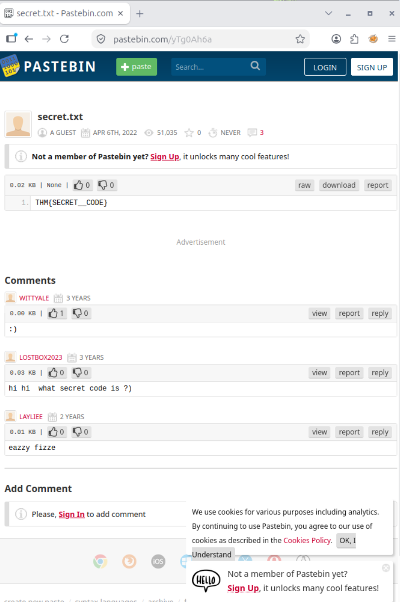

# HTTP C2 Investigation — Elastic/Kibana Network Threat Hunting

## Executive Summary

This case study documents a simulated investigation of an intrusion detection system (IDS) alert for possible HTTP command-and-control (C2) activity. I used **Elastic/Kibana Discover** to examine **1,482 HTTP events** from a March 2022 dataset, isolate an unusual source, and reconstruct requests to an external Pastebin resource.

The key finding was **two HTTP requests** from `192.166.65.54` to `pastebin.com/yTg0Ah6a`: a `HEAD` request and a `GET` request, both reporting a `bitsadmin` user agent and returning HTTP `200`. A separate browser investigation displayed a Pastebin page titled `secret.txt`.

**Assessment:** Suspicious external-resource access warranting investigation, **not confirmed C2**. HTTP metadata did not establish use of `bitsadmin.exe`, malicious command delivery, local file creation, or endpoint execution.

## Scope and Evidence

| Source | Investigative purpose | Limitation |
| --- | --- | --- |
| Kibana Discover HTTP records | Baseline source activity; reconstruct destination, method, URI, user agent, and response | No HTTP response body or endpoint process evidence |
| IDS alert context | Prioritize possible C2 activity for investigation | Alert alone does not verify malicious behavior |
| External Pastebin page | Inspect the URL recovered from HTTP telemetry | Browser content does not prove what the original client received |

### Investigation Method

1. Establish the HTTP event count and source-IP distribution.
2. Filter the unusual source and review its requests.
3. Correlate destination IP, port, hostname, URI, methods, status, and user agent.
4. Reconstruct and inspect the external URL separately.
5. Assess what the network evidence establishes and recommend additional correlation.

## Investigation Findings

### Finding 1 — HTTP Baseline and Source Selection

The selected March 2022 dataset contained **1,482 HTTP events** associated with two source IP addresses:

| Indicator | Observation |
| --- | --- |
| Main source | `192.166.65.52` — approximately 99.6% of events |
| Low-volume source | `192.166.65.54` — approximately 0.4% of events |
| Investigation platform | Elastic/Kibana Discover |

*Figure 1 — Kibana Discover baseline showing the HTTP dataset and available investigative fields.*

I selected `192.166.65.54` for deeper analysis because it differed from the dominant source. **Low event volume was a pivot point, not evidence of compromise.** The next step was to examine the actual HTTP requests attributed to that address.

### Finding 2 — BitsAdmin-Like HTTP Requests

Filtering for `source_ip:192.166.65.54` returned **two HTTP records** with the following indicators:

| Field | Observed value |
| --- | --- |
| Source IP | `192.166.65.54` |
| Destination IP and port | `104.23.99.190:80` |
| HTTP host | `pastebin.com` |
| URI | `/yTg0Ah6a` |
| Request methods | `HEAD`, `GET` |
| HTTP status | `200 OK` |
| Reported user agent | `bitsadmin` |

*Figure 2 — Kibana Discover records showing the two requests to the same Pastebin resource, using `HEAD` and `GET` and reporting `bitsadmin`.*

The `HEAD` request sought response metadata; the `GET` request sought the resource. These methods and the shared URI support the conclusion that the records concern the same external resource. HTTP `200` indicates a successful server response, **not** that a file was written or executed on the endpoint.

The user agent was notable because **BitsAdmin** is a legitimate Windows transfer utility that can be abused. However, user-agent strings are client-controlled. **The evidence supports BitsAdmin-like HTTP traffic, not verified execution of `bitsadmin.exe` or a BITS job.**

**Assessment:** Suspicious remote-resource requests in the context of a possible C2 alert. No beaconing, command exchange, or payload execution was established.

### Finding 3 — External Pastebin Pivot

Combining the HTTP host and URI yielded the observed resource:

`http://pastebin.com/yTg0Ah6a`

An external browser investigation displayed a Pastebin page titled **`secret.txt`** containing a TryHackMe room code. The code is intentionally excluded from this public report.

*Figure 3 — External examination of the referenced Pastebin resource, preserving the page title and investigative context; the room code should be redacted in the public image.*

These observations come from **different evidence sources**:

- **Original HTTP telemetry:** Two requests to the Pastebin URL, each with a `200` response.
- **Separate browser inspection:** The resource displayed a `secret.txt` page and room code at the time of inspection.

The HTTP dataset did not contain response-body content. Therefore, the external page does **not** prove that the original client received identical content, stored it, or acted on it. A paste-hosting site can be used for legitimate sharing or malicious instruction retrieval; the purpose here remains unconfirmed.

**Assessment:** External resource identified and examined; operational C2 activity not established.

## Detection Opportunities

The strongest follow-up detections would correlate unusual web requests with host behavior rather than alerting solely on Pastebin or a user-agent string.

| Detection use case | Suggested logic | Additional evidence needed |
| --- | --- | --- |
| Unusual HTTP client | Surface uncommon `bitsadmin` user agents contacting unexpected hosts | Host process and BITS job telemetry |
| Related resource requests | Correlate `HEAD` and `GET` to the same host and URI within a short interval | Request timestamps and endpoint context |
| External content retrieval | Investigate unexpected access to paste-hosting services in alert context | DNS, proxy, response-body or network capture |
| Possible C2 retrieval | Look for repeated resource requests followed by suspicious endpoint activity | Process creation, file creation, follow-on network traffic |
| Response validation | Determine whether a requested resource was saved or consumed | File-system, EDR, or application telemetry |

**Suggested analyst correlation:** Identify a suspicious HTTP `GET`, attribute the originating process through endpoint evidence, then inspect any resulting file writes, executions, or follow-on connections. These are **proposed detections**, not rules implemented or validated during this exercise.

## MITRE ATT&CK Assessment

The IDS alert suggested a C2 hypothesis, but ATT&CK mapping must reflect the specific evidence:

| Candidate technique | ID | Assessment |
| --- | --- | --- |
| Web Service | `T1102` | **Unconfirmed hypothesis.** Requests reached Pastebin, but there is no evidence the service relayed C2 commands or data. |
| Web Service: Dead Drop Resolver | `T1102.001` | **Insufficient evidence.** No secondary C2 destination, resolver content, or follow-on connection was shown. |
| BITS Jobs | `T1197` | **Insufficient evidence.** `bitsadmin` appeared only as a user-agent value; no BITS job or process was confirmed. |
| Ingress Tool Transfer | `T1105` | **Insufficient evidence.** A `GET` request occurred, but transfer of an attacker tool or payload was not established. |

**No ATT&CK technique is presented as confirmed.** This distinction prevents an alert hypothesis from being mistaken for an observed attacker procedure.

## Evidence Limitations

| Confirmed observation | What remains unverified |
| --- | --- |
| 1,482 HTTP events in the selected dataset | Whether the event distribution represented malicious activity |
| Two records for `192.166.65.54` | Whether the source endpoint was compromised |
| `HEAD` and `GET` to `pastebin.com/yTg0Ah6a` | Response-body content seen by the original client |
| Both responses reported HTTP `200` | Local file creation, ingestion, or execution |
| `bitsadmin` user agent | Actual `bitsadmin.exe` process execution or BITS job use |
| External browser showed `secret.txt` | Original endpoint's receipt or use of that page's content |
| IDS alert raised possible C2 concern | Command exchange, beaconing, or an operational C2 channel |

The recorded IP addresses are preserved **exactly as supplied**. In particular, `192.166.65.54` is not silently changed to the different private-network range `192.168.x.x`.

## Skills Demonstrated

- **Elastic/Kibana:** Discover filtering, event baselining, field-level HTTP analysis.
- **Network investigation:** Source/destination pivots; correlation of methods, hostnames, URIs, statuses, and user agents.
- **IOC analysis:** URL reconstruction and separate external-resource examination.
- **SOC reporting:** C2 hypothesis evaluation, detection recommendations, ATT&CK mapping discipline, and evidence limitations.

## Investigation Takeaway

This exercise demonstrates a fundamental network-investigation distinction: **suspicious requests are not proof of successful C2**. Elastic/Kibana identified an unusual source and two related requests to an external resource. Confirming the mechanism and outcome would require endpoint process, file, network, or response-content evidence not available in the preserved dataset.
