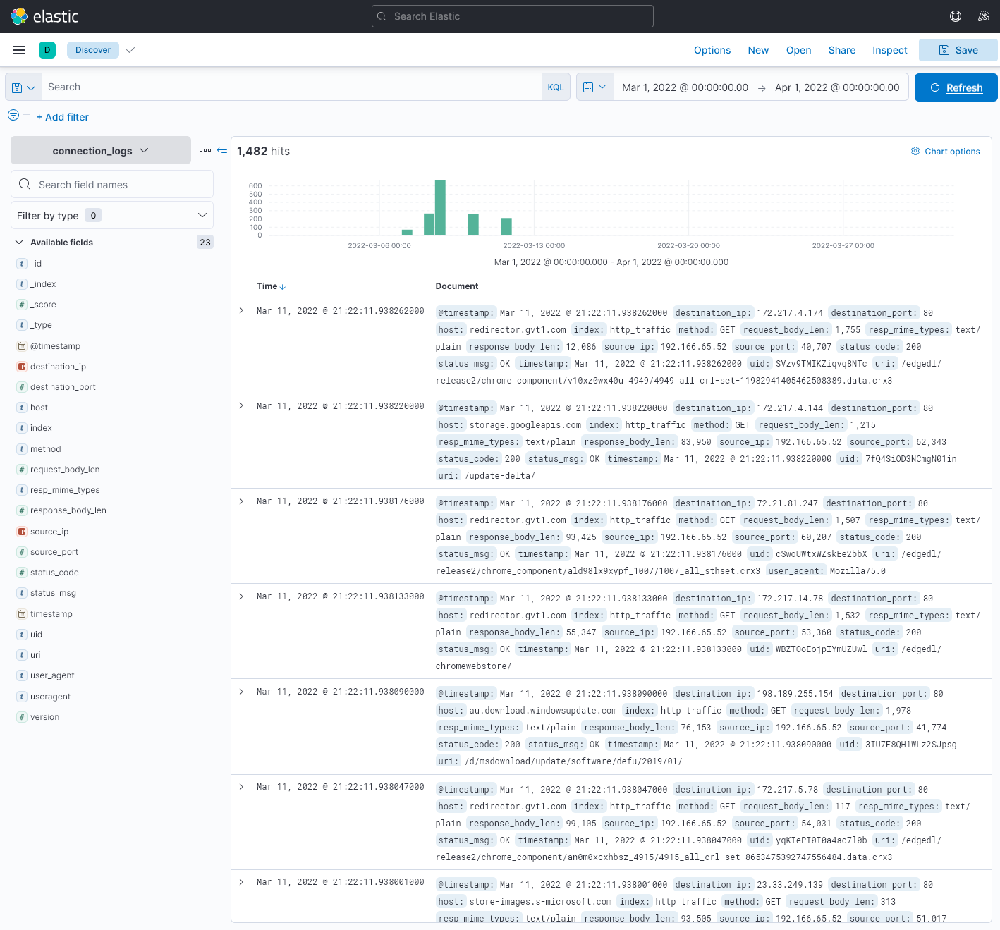
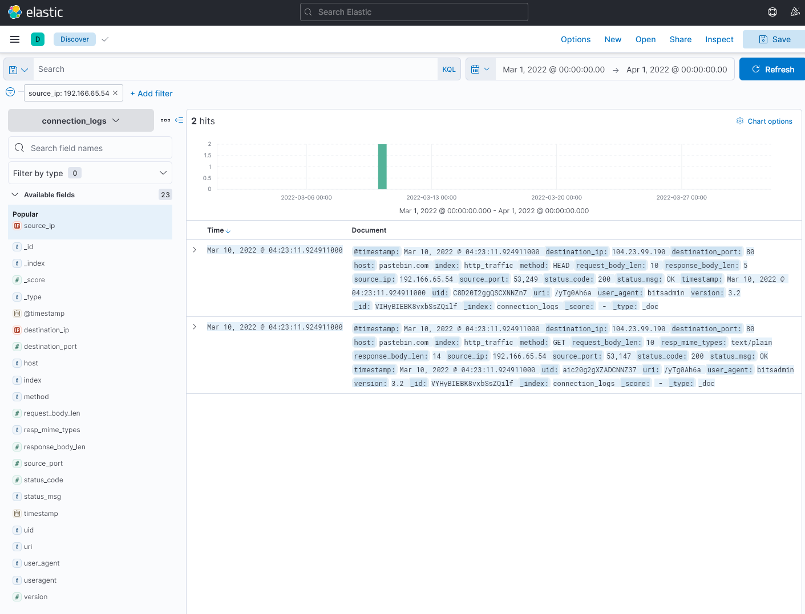

# HTTP Command-and-Control Investigation — Elastic Security Analysis

## Executive Summary

This project documents a simulated network-security investigation involving suspicious HTTP traffic identified through an intrusion detection alert.

Using Elastic/Kibana Discover, I analyzed 1,482 HTTP events from a March 2022 dataset to identify unusual network activity and investigate a potential command-and-control (C2) communication channel.

The investigation identified two HTTP requests associated with the source IP address `192.166.65.54`. Both requests targeted an external Pastebin resource and reported a `bitsadmin` user agent.

The analysis focused on:

- **Traffic baselining:** Examining HTTP event volume and identifying source-IP distributions.
- **Suspicious HTTP activity:** Investigating `HEAD` and `GET` requests to an external Pastebin URL.
- **Indicator investigation:** Reconstructing the requested resource and examining its externally accessible contents.
- **C2 assessment:** Evaluating whether the observed traffic supported a command-and-control hypothesis or an alternative explanation.

The objective was to correlate HTTP metadata, identify potential indicators of compromise, and distinguish suspicious network behavior from confirmed attacker outcomes.

The available evidence supported suspicious remote-content retrieval activity in the context of the supplied IDS alert. It did not independently establish an active C2 session, successful payload execution, or malicious command delivery.

## Investigation Scope

The investigation used HTTP traffic records available through Elastic/Kibana Discover.

The dataset contained **1,482 events** within the selected March 2022 investigation window.

| Investigation Area | Activity Examined | Primary Evidence |
| --- | --- | --- |
| HTTP Traffic Baseline | Event volume and source-IP distribution | Kibana Discover |
| Suspicious Source Investigation | HTTP requests associated with `192.166.65.54` | Filtered HTTP events |
| Network Indicator Analysis | Destination IP, hostname, URI, methods, and user agent | HTTP request metadata |
| External Resource Investigation | Pastebin resource associated with the suspicious requests | External resource screenshot |
| C2 Hypothesis Assessment | Potential remote-content retrieval or C2-related behavior | Correlated HTTP metadata and alert context |

### Investigation Objectives

The investigation sought to answer the following questions:

1. What HTTP activity was present in the available dataset?
2. Which source IP addresses generated the observed requests?
3. Did any source exhibit unusual traffic characteristics?
4. What destination, URI, methods, and user agent were associated with the suspicious activity?
5. Could the HTTP events be used to reconstruct the requested external resource?
6. Did the evidence establish malicious communication, or only suspicious requests?
7. What detection opportunities could be developed from the findings?

## Evidence Sources and Analysis Methodology

### Elastic/Kibana Discover

Kibana Discover was used to search and filter the available HTTP event records.

The investigation began by examining the overall event count and available fields before narrowing the analysis to specific source addresses.

Relevant fields included:

- Source IP address
- Destination IP address and port
- HTTP request method
- HTTP hostname and URI
- HTTP response status
- HTTP user agent
- Event timestamps

These fields provided sufficient context to reconstruct the observed HTTP requests without requiring access to the original network packets.

### HTTP Metadata Analysis

The investigation examined request and response metadata to determine which resources were accessed and how the HTTP client identified itself.

The observed `bitsadmin` user agent was an important indicator because it suggested activity involving a Windows background-transfer mechanism.

However, user-agent strings are client-supplied values. The HTTP metadata alone did not prove that `bitsadmin.exe` executed on the source endpoint.

Similarly, an HTTP `200 OK` response indicates successful server handling of the request, but does not independently establish that the response content was saved or executed.

### External Indicator Investigation

The hostname and URI recovered from the HTTP events were used to reconstruct the external resource URL.

The resource was examined separately to determine what information was displayed.

The external page provided investigative context but was not treated as proof that the original HTTP client received, saved, or executed the same content.

### Investigation Methodology

| Step | Analyst Activity |
| --- | --- |
| Establish Baseline | Review HTTP event volume and source distributions |
| Identify Anomaly | Select unusual sources for deeper investigation |
| Filter | Narrow events using source-IP and HTTP fields |
| Correlate | Compare methods, destinations, URIs, timestamps, and user agents |
| Investigate IOC | Reconstruct and examine the external resource |
| Assess | Evaluate the C2 hypothesis and evidence limitations |
| Recommend | Identify practical detection and monitoring opportunities |

### Evidence Standards

The analysis distinguished observed network events from inferred attacker objectives.

- Low-volume traffic alone does not establish malicious intent.
- An HTTP user-agent string does not independently identify the executable responsible for a request.
- A successful HTTP response does not prove that content was saved or executed.
- Access to an external Pastebin resource does not independently confirm command-and-control activity.
- Without endpoint telemetry or response-body evidence, the complete purpose and outcome of the requests remain uncertain.

The investigation therefore classified the activity as suspicious and consistent with possible C2-related retrieval, rather than confirmed command-and-control execution.

## Investigation Organization

The report follows the investigative workflow:

1. **HTTP Traffic Baseline:** Establishing the event count and identifying unusual sources.
2. **Suspicious HTTP Requests:** Investigating the low-volume source and its Pastebin activity.
3. **External IOC Investigation:** Reconstructing and examining the requested resource.
4. **Detection and Defensive Analysis:** Identifying monitoring opportunities and mapping relevant ATT&CK techniques.

The final sections document evidence limitations, investigation outcomes, and skills demonstrated.

## Investigation Findings

### Finding 1 — HTTP Traffic Baseline and Source Identification

#### Investigation Context

The investigation began with an IDS alert indicating potential command-and-control (C2) activity.

Before examining any particular destination or indicator, I used Kibana Discover to establish a baseline of the available HTTP telemetry.

The selected March 2022 dataset contained **1,482 HTTP events** associated with two source IP addresses.

#### HTTP Traffic Analysis

The initial analysis focused on the distribution of network activity across source addresses.

| Indicator | Observation |
| --- | --- |
| Platform | Elastic/Kibana Discover |
| Investigation period | March 2022 |
| Total HTTP events | 1,482 |
| Primary source IP | `192.166.65.52` |
| Secondary source IP | `192.166.65.54` |
| Primary source share | Approximately 99.6% |
| Secondary source share | Approximately 0.4% |

*Figure 1 — Kibana Discover showing the HTTP investigation dataset, event volume, and available telemetry fields used to establish the traffic baseline.*

The majority of HTTP events were associated with `192.166.65.52`, while `192.166.65.54` accounted for a small proportion of the dataset.

This difference provided a useful starting point for investigation, but traffic volume alone was not sufficient to establish malicious behavior.

#### Suspicious Source Selection

I selected `192.166.65.54` for further investigation because it stood out from the dominant traffic source.

Rather than assigning a malicious classification based on the low event count, I examined the HTTP requests associated with the address to identify destinations, request methods, user agents, and response characteristics.

The next stage of the investigation narrowed the dataset to this source IP and examined its HTTP activity.

#### Analyst Assessment

**Assessment: HTTP traffic baseline established; low-volume source selected for further analysis.**

The initial investigation identified a potentially interesting source but did not independently establish command-and-control activity.

The significance of `192.166.65.54` would depend on the content and characteristics of its observed HTTP requests.

### Finding 2 — Suspicious BitsAdmin HTTP Requests

#### Investigation Context

After identifying `192.166.65.54` as a low-volume source, I filtered the HTTP dataset in Kibana Discover to examine its network activity.

The filtered results contained two HTTP requests targeting an external Pastebin resource.

Both requests reported a `bitsadmin` user agent, which raised concern about potential misuse of a legitimate Windows background-transfer mechanism.

The investigation focused on correlating source and destination addresses, HTTP methods, the requested resource, and response status.

#### HTTP Request Analysis

Filtering the dataset for `source_ip:192.166.65.54` returned two events associated with the same external destination.

| Indicator | Observed Value |
| --- | --- |
| Source IP | `192.166.65.54` |
| Destination IP | `104.23.99.190` |
| Destination port | `80` |
| HTTP host | `pastebin.com` |
| HTTP URI | `/yTg0Ah6a` |
| Request methods | `HEAD`, `GET` |
| HTTP response | `200 OK` |
| Reported user agent | `bitsadmin` |

*Figure 2 — Kibana Discover showing two HTTP requests from `192.166.65.54` to `pastebin.com/yTg0Ah6a`, using `HEAD` and `GET` methods and reporting a `bitsadmin` user agent.*

The `HEAD` request was consistent with retrieving HTTP response metadata, while the `GET` request was consistent with requesting the resource's content.

Both requests targeted the same Pastebin path, suggesting related activity rather than unrelated browsing events.

An HTTP `200 OK` response indicated that the server successfully handled the request. However, the HTTP metadata did not establish whether the response body was saved locally or subsequently executed.

#### BitsAdmin User-Agent Assessment

BitsAdmin is a legitimate Windows utility associated with Background Intelligent Transfer Service operations.

Its appearance in the reported user-agent field was suspicious in the context of the IDS alert and the unusual external destination.

However, HTTP user-agent values are supplied by clients and can be modified or impersonated.

The available network telemetry therefore supported an assessment of **BitsAdmin-like HTTP activity**, but did not independently confirm execution of `bitsadmin.exe` on the source endpoint.

#### Analyst Assessment

**Assessment: Suspicious HTTP requests consistent with potential remote-content retrieval.**

The two requests established communication with an external Pastebin resource using `HEAD` and `GET` methods and a reported `bitsadmin` user agent.

The observed behavior warranted further investigation for possible command-and-control or external content retrieval activity.

However, the evidence did not independently establish an active C2 session, malicious command delivery, or execution of downloaded content.

#### Detection Opportunities

- Monitor HTTP activity using unexpected or uncommon user-agent strings, including `bitsadmin`.
- Correlate suspicious HTTP user agents with endpoint process-creation telemetry where available.
- Investigate scripted HTTP requests to paste sites or other external content-hosting services.
- Identify related `HEAD` and `GET` requests targeting the same resource.
- Correlate HTTP requests with DNS, proxy, and endpoint telemetry to establish broader activity.
- Avoid classifying traffic as confirmed C2 solely because it uses a suspicious user agent or external hosting service.